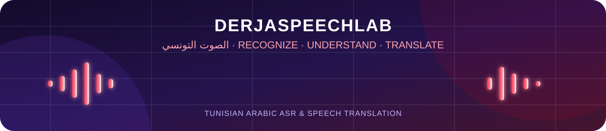
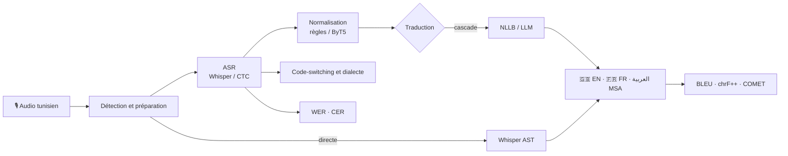

<div align="center">
  

  # DerjaSpeechLab

  **Tunisian Arabic ASR · Speech Translation · Text Normalization · Dialect Analysis**

  [](https://www.python.org/)
  [](https://pytorch.org/)
  [](https://huggingface.co/docs/transformers/)
  [](#cadre-acad%C3%A9mique-et-%C3%A9thique)

  *من الصوت التونسي إلى نصّ وترجمة قابلة للتحليل*

  Un laboratoire reproductible pour reconnaître la **derja tunisienne**, analyser le **code-switching**
  arabe–français–anglais et traduire la parole vers l’anglais, le français ou l’arabe standard.
</div>

---

## Vue d’ensemble

DerjaSpeechLab étudie la reconnaissance automatique de la parole (ASR) et la traduction de la parole
tunisienne sur le corpus [TEDxTN](https://huggingface.co/datasets/fbougares/TEDxTN). Le projet compare des
approches directes et en cascade, puis documente l’effet de la normalisation orthographique, du
code-switching et des erreurs ASR sur la traduction.

Le dépôt réunit :

- des notebooks reproductibles, de la préparation des données à l’évaluation ;
- une chaîne ASR basée sur Whisper et des expériences CTC/KenLM ;
- des systèmes de traduction directe et en cascade avec NLLB ;
- des modules de normalisation, d’identification dialectale et d’analyse d’erreurs ;
- une interface Gradio, **Derja Voice Lab**, qui visualise neuf étapes du traitement ;
- les prédictions, métriques, figures et journaux nécessaires à l’audit des résultats.

> [!IMPORTANT]
> Les fichiers audio et les modèles entraînés ne sont pas distribués. Ils sont téléchargés ou produits
> localement dans `workdir/`, conformément aux contraintes de licence et de taille.

## Résultats principaux

Tous les chiffres ci-dessous proviennent du test officiel et des artefacts versionnés dans `results/`.
Les intervalles de confiance sont calculés par bootstrap à 95 %.

| Tâche | Système | Résultat | Taille du test |
|---|---|---:|---:|
| ASR | Whisper-small fine-tuné, beam 5 | **WER 32,06** · CER 15,75 | 842 segments |
| Traduction en cascade | Whisper-small FT → NLLB LoRA | **BLEU 22,78** · chrF++ 46,59 · COMET 67,03 | 841 segments |
| Traduction directe | Whisper-small initialisé depuis l’ASR | **BLEU 20,92** · chrF++ 44,70 | 841 segments |
| Normalisation | ByT5 sur variantes jamais vues | **83,71 %** d’exactitude | dev + test |
| Type de code-switching audio | classifieur train → test | **F1 macro 0,689** | test officiel |

Les tableaux complets, les limites et le protocole de sélection des modèles sont détaillés dans
[`RESULTATS.md`](RESULTATS.md). Les incidents expérimentaux et leurs corrections sont consignés dans
[`CHANGELOG_EXECUTION.md`](CHANGELOG_EXECUTION.md).

## Pipeline



L’interface expose le signal, le spectrogramme log-Mel, la transcription et sa confiance par token, le
code-switching, la normalisation, la traduction et le temps de chaque étape.

## Démarrage rapide

### Installation locale

Pré-requis : Python 3.10 à 3.13, Git, FFmpeg et, pour l’entraînement, un GPU CUDA.

```bash
git clone https://github.com/Nour-Ghribi/DerjaSpeechLab-Tunisian-Arabic-ASR-Speech-Translation.git
cd DerjaSpeechLab-Tunisian-Arabic-ASR-Speech-Translation

python -m venv .venv
```

Activation de l’environnement :

```bash
# Linux / macOS
source .venv/bin/activate

# Windows PowerShell
.venv\Scripts\Activate.ps1
```

Puis :

```bash
pip install -r requirements.txt
python scripts/prepare_data.py
python tests/test_core.py
python app/app.py
```

L’interface locale est ensuite disponible sur <http://localhost:7860>.

### Google Colab

Les notebooks détectent Colab, montent Google Drive et clonent ce dépôt si nécessaire. Ouvrez-les dans
l’ordre indiqué ci-dessous, choisissez un runtime GPU, puis exécutez toutes les cellules. Les checkpoints et
les modèles restent dans `MyDrive/tedxtn` grâce à `TEDXTN_WORKDIR`.

## Parcours expérimental

| Ordre | Notebook | Objectif | Sorties principales |
|---:|---|---|---|
| 1 | [`01_Tunisian_ASR.ipynb`](notebooks/01_Tunisian_ASR.ipynb) | ASR, baselines, fine-tuning et analyse d’erreurs | modèles ASR, WER/CER, prédictions |
| 1b | [`01b_w2v-BERT_Colab.ipynb`](notebooks/01b_w2v-BERT_Colab.ipynb) | expérience w2v-BERT / CTC | prédictions CTC |
| 2 | [`02_Speech_to_Text_Translation.ipynb`](notebooks/02_Speech_to_Text_Translation.ipynb) | traduction directe vs cascade | BLEU, chrF++, COMET |
| 3 | [`03_Text_Normalization.ipynb`](notebooks/03_Text_Normalization.ipynb) | règles, lexique et ByT5 | ablations et exactitude OOV |
| 4 | [`04_Dialect_Identification.ipynb`](notebooks/04_Dialect_Identification.ipynb) | région et type de code-switching | accuracy et F1 macro |
| 5 | [`05_Interface_Demo.ipynb`](notebooks/05_Interface_Demo.ipynb) | démonstration interactive | interface Gradio partageable |

Les notebooks 03 et 04 peuvent être exécutés en parallèle des expériences ASR/AST. Chaque système écrit
ses sorties dans `results/preds/<tâche>__<système>__<split>.csv`, ce qui permet d’évaluer et de comparer les
modèles sans relancer leur entraînement.

## Structure du dépôt

```text
.
├── app/                 # interface Gradio « Derja Voice Lab »
├── common/              # données, ASR, traduction, métriques et pipeline partagé
├── notebooks/           # six notebooks d’expérimentation et de démonstration
├── results/             # métriques, figures et prédictions reproductibles
├── scripts/             # préparation, entraînement, monitoring et contrôles
├── tests/               # tests CPU du cœur du projet
├── RESULTATS.md         # rapport expérimental complet
├── CHANGELOG_EXECUTION.md
└── requirements.txt
```

### Modules principaux

| Module | Rôle |
|---|---|
| `common/data.py` | annotations, récupération audio, segmentation et contrôle des fuites |
| `common/asr.py` | Whisper, LoRA, CTC, décodage et scores de confiance |
| `common/translate.py` | NLLB, SeamlessM4T et modèles speech-to-text |
| `common/text.py` | scripts, code-switching et normalisation tunisienne |
| `common/metrics.py` | WER/CER, BLEU, chrF++, COMET, bootstrap et analyses |
| `common/pipeline.py` | orchestration des étapes et traces de l’interface |
| `common/llm.py` | post-correction, normalisation et traduction assistées par LLM |

## Utiliser Derja Voice Lab

```bash
# Modèles par défaut ou fallback vers les modèles de base
python app/app.py

# Créer un lien Gradio public
python app/app.py --share

# Choisir explicitement les modèles
python app/app.py \
  --asr workdir/models/asr_best \
  --mt facebook/nllb-200-distilled-600M
```

Variables utiles : `TEDXTN_ASR_MODEL`, `TEDXTN_AST_MODEL`, `TEDXTN_MT_MODEL`, `TEDXTN_LLM_MODEL` et
`TEDXTN_WORKDIR`.

## Reproductibilité

- graine fixe `SEED = 42` pour les tirages, augmentations et entraînements ;
- splits officiels avec contrôles des fuites de talk, texte et segment ;
- sélection des hyperparamètres sur le dev, évaluation finale sur le test ;
- prédictions et courbes d’entraînement conservées dans `results/` ;
- intervalles de confiance à 95 % et comparaisons appariées ;
- tests CPU exécutables avec `python tests/test_core.py` ;
- dépendances déclarées dans `requirements.txt`, avec `transformers < 5`.

Les modèles sont coûteux à entraîner. Les interrupteurs placés en tête des notebooks
(`RUN_WHISPER_FT`, `RUN_CTC_FT`, `RUN_LLM`, etc.) désactivent automatiquement les étapes GPU indisponibles et
permettent de rejouer l’exploration et l’évaluation sur CPU.

## Cadre académique et éthique

Ce dépôt est un projet de recherche et d’apprentissage. Il ne doit pas être interprété comme un système de
transcription certifié, et ses performances peuvent varier selon la région, l’accent, le microphone, le genre,
l’âge et le contexte de parole.

Le corpus TEDxTN est distribué sous **CC BY-NC-ND 4.0**. En particulier :

- l’usage est non commercial ;
- l’audio n’est ni versionné ni redistribué ici ;
- les URL et segments signalés comme incertains doivent être vérifiés manuellement ;
- les modèles fine-tunés et données dérivées doivent rester dans un espace autorisé ;
- toute publication de résultats doit citer le corpus et décrire le protocole.

La licence du corpus ne constitue pas une licence pour le code de ce dépôt. En l’absence de fichier `LICENSE`,
aucun droit général de réutilisation du code n’est implicitement accordé ; contactez les contributrices avant
réutilisation ou redistribution.

## Citation

Si ce dépôt vous aide dans un travail académique, vous pouvez le citer ainsi :

```bibtex
@software{derjaspeechlab_2026,
  title  = {DerjaSpeechLab: Tunisian Arabic ASR and Speech Translation},
  author = {Ghribi, Nour and contributors},
  year   = {2026},
  url    = {https://github.com/Nour-Ghribi/DerjaSpeechLab-Tunisian-Arabic-ASR-Speech-Translation}
}
```

Merci de citer également l’article et le corpus TEDxTN :

> F. Bougares et al. (2025). *TEDxTN: A Three-way Speech Translation Corpus for Code-Switched Tunisian
> Arabic–English*. ArabicNLP 2025. [Article ACL Anthology](https://aclanthology.org/2025.arabicnlp-main.22/)

## Références techniques

Whisper · w2v-BERT 2.0 · MMS · SeamlessM4T · NLLB · LoRA · SpecAugment · KenLM · sacreBLEU · chrF++ ·
COMET · CODA-TUN · ByT5. Les références détaillées et leur rôle expérimental figurent dans les notebooks.

---

<div align="center">
  <sub>Built for Tunisian Arabic speech research — بالصوت التونسي، للبحث المفتوح والمسؤول 🇹🇳</sub>
</div>
